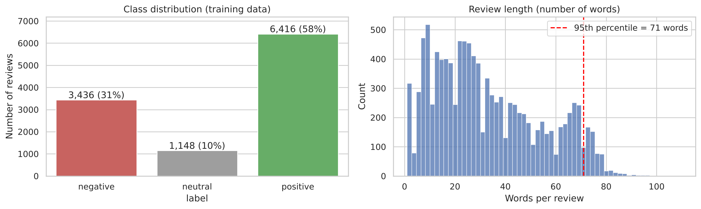
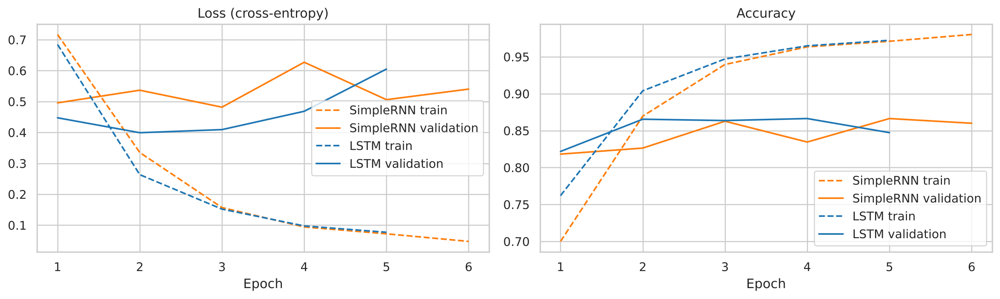
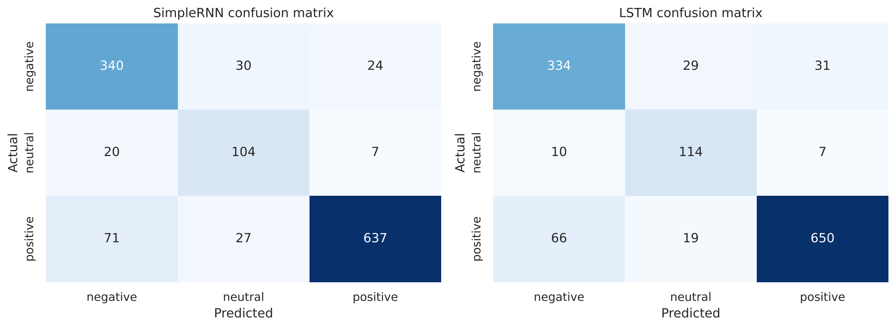
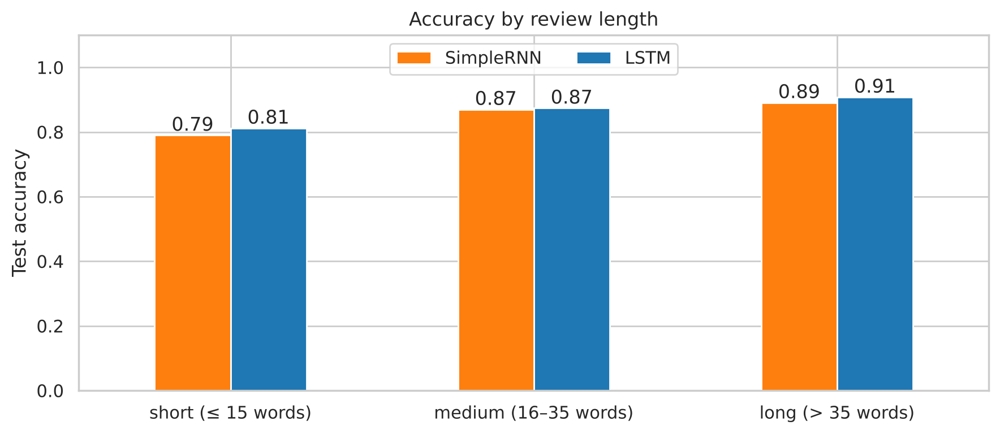
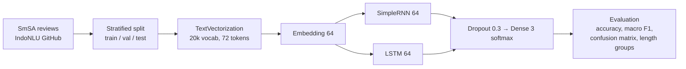

# Indonesian Review Sentiment Analysis with RNN and LSTM

[](https://colab.research.google.com/github/joysonkustiadi-creator/sentiment-analysis-of-indonesian-reviews/blob/main/RNN_LSTM_Indonesian_Sentiment.ipynb)


A deep learning project that classifies Indonesian customer reviews as **positive**, **neutral** or **negative**. It compares a **Simple Recurrent Neural Network (SimpleRNN)** with a **Long Short-Term Memory (LSTM)** network trained under identical settings.

**Result:** the LSTM reaches **87.1% test accuracy (macro F1 0.841)**, compared with 85.8% (macro F1 0.815) for the SimpleRNN.

**Author:** Joshua Joyson Kustiadi, Computer Science, Bina Nusantara University
**Course:** Deep Learning, Fundamental Aspects of RNN and LSTM

---

## Table of Contents

1. [Introduction](#1-introduction)
2. [Case Description](#2-case-description)
3. [Data Description](#3-data-description)
4. [Performance Analysis](#4-performance-analysis)
5. [Coding](#5-coding)
6. [References](#references)

---

## 1. Introduction

Text is **sequential data**: the meaning of a sentence depends on the order of its words. *"Makanan nya enak"* (the food is tasty) is positive, but adding one word, *"makanan nya **tidak** enak"* (the food is **not** tasty), flips it to negative. A model that treats a review as an unordered bag of words cannot see this.

**Recurrent Neural Networks** solve this by reading a sequence one element at a time while carrying a memory, the hidden state $h_t$, from step to step:

$$h_t = \tanh\left(W_{xh}\,x_t + W_{hh}\,h_{t-1} + b_h\right)$$

A plain RNN has a known weakness. During training with Backpropagation Through Time (BPTT), the gradient is multiplied by $W_{hh}$ and the derivative of $\tanh$ at every step back, so it can **vanish** over long sequences. The **LSTM** adds a cell state $c_t$ and three gates (forget, input, output). Because the cell state is updated by addition, $c_t = f_t \odot c_{t-1} + i_t \odot \tilde{c}_t$, the LSTM can learn to keep information much longer.

### Objectives

1. Apply RNN and LSTM to a real problem: sentiment analysis of Indonesian reviews.
2. Use a public, labelled, real-world dataset (SmSA from the IndoNLU benchmark).
3. Train both models with **identical settings** and compare them on accuracy, macro F1, per-class results and review length.
4. Connect the implementation to the theory: cost function, hidden-state update, shared weights and BPTT.

---

## 2. Case Description

### The problem

Indonesian businesses such as restaurants, hotels, online shops and app developers receive thousands of reviews every day on platforms like Google Maps, TripAdvisor, Tokopedia and the Play Store. Nobody can read them all by hand, but the business still needs answers:

- Are customers happier or unhappier than last week?
- Which reviews are complaints that need a fast reply?
- Did a new menu, price or app update change how people feel?

An automatic sentiment classifier turns this flood of text into a signal the business can monitor and act on.

### Task formulation

| Item | Description |
|---|---|
| Input | The text of one review, a sequence of words $x_1, x_2, \dots, x_T$ |
| Output | One label: `negative`, `neutral` or `positive` |
| Sequence type | **Many-to-one**: a whole sequence in, one label out |
| Model output | Probabilities for the three classes from a softmax layer on the last hidden state $h_T$ |

### Why a recurrent model fits this case

| Example review | Label | What the model must understand |
|---|---|---|
| *makanan nya enak sekali* | positive | Basic positive words |
| *makanan nya **tidak** enak* | negative | Negation changes the meaning of the next word |
| *tempat nya bagus **tapi** harga nya terlalu mahal* | negative | The clause after "tapi" (but) carries the verdict |
| *besok rapat dimulai pukul sembilan* | neutral | Factual text with no opinion |

### Challenges

- **Class imbalance:** neutral reviews are only about 10% of the data.
- **Informal language:** slang, typos and abbreviations (e.g. *mmbri* for *memberi*).
- **Mixed sentiment:** many reviews praise one thing and criticise another.
- **Variable length:** reviews range from 1 to 110 words.

---

## 3. Data Description

### Source

The project uses **SmSA** (Sentiment Analysis on Indonesian reviews), one of the tasks in the **IndoNLU benchmark** ([Wilie et al., 2020](https://github.com/IndoNLP/indonlu)). The data was originally collected by Prosa.ai ([Purwarianti & Crisdayanti, 2019](#references)) from Indonesian online reviews and comments and labelled by hand. The notebook downloads it directly from the IndoNLU GitHub repository, so no manual download is needed.

### Files and splits

| File in IndoNLU | Rows | Used in this project as |
|---|---|---|
| `train_preprocess.tsv` | 11,000 | 9,900 training + 1,100 validation (stratified 90/10 split) |
| `valid_preprocess.tsv` | 1,260 | **Test set**, never seen during training |
| `test_preprocess_masked_label.tsv` | 500 | Not used: its labels are hidden for the benchmark leaderboard |

### Columns

| Column | Type | Description |
|---|---|---|
| `text` | string | The review, already lower-cased, with punctuation separated by spaces |
| `label` | string | `positive`, `neutral` or `negative` |

### Sample rows

| text (shortened) | label |
|---|---|
| *lokasi strategis di jalan sumatera bandung . tempat nya nyaman terutama sofa di lantai 2 . paella nya enak ...* | positive |
| *kita akhir pekan ke sana . sesak dan antre . ... mahal dan tidak ada yang enak ...* | negative |
| *pan yakin bahwa hasil pilkada akan berpengaruh ke pilpres .* | neutral |

### Class distribution and review length



| Statistic (training data, 11,000 reviews) | Value |
|---|---|
| Positive / negative / neutral | 6,416 (58%) / 3,436 (31%) / 1,148 (10%) |
| Mean review length | 32.9 words |
| Median review length | 28 words |
| Shortest / longest review | 1 / 110 words |

**Takeaways:** the classes are imbalanced, so the models use **class weights** and are judged by **macro F1** as well as accuracy. Most reviews are short, but a long tail goes past 70 words, so the models must carry information across many time steps.

### Preprocessing

1. **Vocabulary:** `TextVectorization` keeps the 20,000 most frequent words from the training split (17,034 distinct words were found). Unknown words map to `[UNK]` and id 0 is padding.
2. **Sequence length:** every review is padded or cut to **72 tokens**, the 95th percentile of review length.
3. **Embedding:** each word id becomes a 64-dimensional vector $x_t$, learned during training. `mask_zero=True` makes the recurrent layer skip the padding.
4. **The -nya suffix:** the dataset writes *-nya* as a separate token (*makanan nya* appears 831 times, *makanannya* never). New sentences typed by a user are normalised the same way before prediction.
5. **Class weights:** negative 1.07, neutral 3.19, positive 0.57, so mistakes on the rare neutral class cost more.

---

## 4. Performance Analysis

### Experimental setup

Both models use exactly the same pipeline and settings. Only the recurrent layer differs.

| Setting | Value |
|---|---|
| Architecture | Embedding(64) → SimpleRNN(64) **or** LSTM(64) → Dropout(0.3) → Dense(3, softmax) |
| Loss (cost function) | Sparse categorical cross-entropy, with class weights |
| Optimiser | Adam, learning rate 0.001, gradient clipping (clipnorm = 1.0) |
| Batch size / max epochs | 64 / 20 |
| Early stopping | Stops when validation loss has not improved for 3 epochs, then restores the best weights |
| Random seed | 42 |
| Recurrent-layer parameters | SimpleRNN 8,256 · LSTM 33,024 (exactly 4×, one set per gate) |
| Total parameters | SimpleRNN 1,288,451 · LSTM 1,313,219 |

### Overall results on the test set (1,260 reviews)

| Model | Accuracy | Macro F1 | Best validation loss | Best epoch |
|---|---|---|---|---|
| SimpleRNN | 0.858 | 0.815 | 0.482 | 3 |
| **LSTM** | **0.871** | **0.841** | **0.399** | **2** |

### Per-class results

| Class (test reviews) | SimpleRNN precision | SimpleRNN recall | SimpleRNN F1 | LSTM precision | LSTM recall | LSTM F1 |
|---|---|---|---|---|---|---|
| Negative (394) | 0.789 | 0.863 | 0.824 | 0.815 | 0.848 | **0.831** |
| Neutral (131) | 0.646 | 0.794 | 0.712 | 0.704 | 0.870 | **0.778** |
| Positive (735) | 0.954 | 0.867 | 0.908 | 0.945 | 0.884 | **0.914** |

### Learning curves



Both models fit the training data quickly: training accuracy is above 96% by epoch 4. Validation loss stops improving after 2–3 epochs, which means the models start to **overfit** from there. Early stopping restores the best weights. The LSTM's validation loss is lower in the first four epochs and reaches a better minimum (0.399 vs 0.482).

### Confusion matrices



- The LSTM gets **114 of 131 neutral reviews right**, compared with 104 for the SimpleRNN, and confuses fewer neutral reviews with negative ones (10 vs 20).
- The most common error for both models is a **positive review predicted as negative** (71 for SimpleRNN, 66 for LSTM). Many of these are mixed reviews that praise and criticise at the same time.

### Accuracy by review length



| Length group | Test reviews | SimpleRNN | LSTM |
|---|---|---|---|
| Short (≤ 15 words) | 309 | 0.790 | 0.812 |
| Medium (16–35 words) | 485 | 0.870 | 0.874 |
| Long (> 35 words) | 466 | 0.891 | 0.908 |

The LSTM is ahead in all three groups, but the gap does **not** clearly grow with length. Reviews here are at most 72 tokens, and long reviews tend to state their opinion several times, so a model rarely needs to remember the very first word. The vanishing-gradient advantage of the LSTM would matter more on much longer sequences. **Short reviews are hardest for both models** because they give little context (e.g. a one-word review like *"makmur"*).

### Predictions on new reviews

These sentences were written for testing and are not in the dataset.

| New review | SimpleRNN | LSTM |
|---|---|---|
| makanannya enak sekali dan pelayanannya ramah | positive (92%) | positive (87%) |
| makanannya tidak enak dan pelayanannya lambat | negative (63%) | negative (67%) |
| tempatnya bagus tapi harganya terlalu mahal dan pelayannya tidak ramah | negative (68%) | negative (56%) |
| aplikasi ini sangat membantu , pengiriman cepat dan barang sesuai pesanan | positive (82%) | positive (78%) |
| aplikasinya sering error dan tidak bisa login , sangat mengecewakan | negative (76%) | negative (88%) |
| besok rapat akan dimulai pukul sembilan pagi di kantor | neutral (92%) | neutral (97%) |

Both models handle negation (*tidak enak*) and the mixed "good place **but** expensive" review correctly.

### Conclusion

1. Both recurrent models solve the task well, at about 86–87% accuracy on unseen reviews.
2. The **LSTM is better on every metric**, most clearly on the rare neutral class (F1 0.712 → 0.778), and it reaches a lower validation loss in fewer epochs.
3. The LSTM's lead does not grow with review length in this dataset, because the sequences are short (at most 72 tokens) and opinions are repeated throughout.
4. The results come from a single run (seed 42). Repeating it with several seeds would show how stable the gap between the models is.

### Limitations and future work

- Word vectors are learned from only about 10,000 reviews. Pre-trained Indonesian embeddings (fastText) or a Transformer such as **IndoBERT** would handle rare words and slang better.
- A **Bidirectional LSTM** reads the review in both directions and usually adds a few points of accuracy.
- Reviews longer than 72 tokens are cut, so the end of very long reviews is not seen.
- Results can change slightly between runs and between CPU and GPU, even with a fixed seed.

---

## 5. Coding

### Repository structure

```
sentiment-analysis-of-indonesian-reviews/
├── README.md                              # this documentation
├── RNN_LSTM_Indonesian_Sentiment.ipynb    # full notebook, with outputs
├── requirements.txt                       # Python packages for running locally
└── images/                                # charts used in this README
    ├── data_overview.png
    ├── learning_curves.png
    ├── confusion_matrices.png
    └── accuracy_by_length.png
```

### How to run

**Option A: Google Colab (recommended)**

1. Click the **Open in Colab** badge at the top of this page.
2. Choose *Runtime → Run all*. A GPU is optional; on CPU the whole notebook takes about 2–3 minutes.

**Option B: locally**

```bash
git clone https://github.com/joysonkustiadi-creator/sentiment-analysis-of-indonesian-reviews.git
cd sentiment-analysis-of-indonesian-reviews
pip install -r requirements.txt
jupyter notebook RNN_LSTM_Indonesian_Sentiment.ipynb
```

### Pipeline



### Key code

**1. Load the data directly from GitHub**

```python
BASE_URL = "https://raw.githubusercontent.com/IndoNLP/indonlu/master/dataset/smsa_doc-sentiment-prosa/"

def load_tsv(name):
    return pd.read_csv(BASE_URL + name, sep="\t", header=None,
                       names=["text", "label"], quoting=csv.QUOTE_NONE)

train_full = load_tsv("train_preprocess.tsv")
test_df    = load_tsv("valid_preprocess.tsv")   # official validation split = our test set
```

**2. Turn text into sequences of word ids**

```python
train_df, val_df = train_test_split(train_full, test_size=0.10,
                                    stratify=train_full["label"], random_state=SEED)

MAX_TOKENS = 20_000
MAX_LEN = int(np.percentile(train_df["n_words"], 95))   # 72 time steps

vectorizer = layers.TextVectorization(max_tokens=MAX_TOKENS, output_sequence_length=MAX_LEN,
                                      standardize="lower_and_strip_punctuation")
vectorizer.adapt(train_df["text"].values)               # vocabulary from training data only
```

**3. Build the SimpleRNN and LSTM models with the same structure**

```python
def build_model(cell="lstm"):
    inputs = keras.Input(shape=(MAX_LEN,), dtype="int64")
    x = layers.Embedding(MAX_TOKENS, 64, mask_zero=True)(inputs)   # word id -> x_t
    if cell == "rnn":
        x = layers.SimpleRNN(64)(x)    # h_t = tanh(W_xh x_t + W_hh h_{t-1} + b_h), returns h_T
    else:
        x = layers.LSTM(64)(x)         # gates + cell state, returns h_T
    x = layers.Dropout(0.3)(x)
    outputs = layers.Dense(3, activation="softmax")(x)
    model = keras.Model(inputs, outputs)
    model.compile(optimizer=keras.optimizers.Adam(1e-3, clipnorm=1.0),
                  loss="sparse_categorical_crossentropy", metrics=["accuracy"])
    return model
```

**4. Train with class weights and early stopping (BPTT happens inside `fit`)**

```python
early_stop = keras.callbacks.EarlyStopping(monitor="val_loss", patience=3,
                                           restore_best_weights=True)
history = model.fit(X_train, y_train, validation_data=(X_val, y_val),
                    epochs=20, batch_size=64, class_weight=class_weights,
                    callbacks=[early_stop])
```

**5. Predict new reviews**

```python
def normalize(text):                         # makanannya -> makanan nya, as in the dataset
    words = []
    for w in text.lower().split():
        if w not in vocab_set and w.endswith("nya") and w[:-3] in vocab_set:
            words += [w[:-3], "nya"]
        else:
            words.append(w)
    return " ".join(words)

def predict(texts, model):
    probs = model.predict(vectorizer(np.array([normalize(t) for t in texts])), verbose=0)
    return [(id2label[p.argmax()], p.max()) for p in probs]

predict(["makanannya tidak enak dan pelayanannya lambat"], lstm_model)
# -> negative, 67% confidence
```

### From theory to code

| Concept | Where it appears in the code |
|---|---|
| Sequential input $x_1, \dots, x_T$ | `TextVectorization` + `Embedding` turn a review into 72 word vectors |
| Hidden state $h_t = \tanh(W_{xh} x_t + W_{hh} h_{t-1} + b_h)$ | `layers.SimpleRNN(64)` |
| Gates and cell state $c_t = f_t \odot c_{t-1} + i_t \odot \tilde{c}_t$ | `layers.LSTM(64)` |
| Shared weights across time steps | Parameter count is independent of sequence length: 64 × (64 + 64 + 1) = 8,256 for SimpleRNN, 4 × that for LSTM |
| Many-to-one output | Only the last hidden state $h_T$ goes to the `Dense` softmax layer |
| Cost function $L = -\sum_k y_k \log \hat{y}_k$ | `loss="sparse_categorical_crossentropy"` |
| Backpropagation Through Time | Done automatically by `model.fit()` on the unrolled network |
| Exploding-gradient protection | `clipnorm=1.0` in the Adam optimiser |

### Requirements

Google Colab already has everything installed. For local runs, see [`requirements.txt`](requirements.txt): TensorFlow ≥ 2.15, pandas, NumPy, scikit-learn, Matplotlib and Seaborn. The results above were produced with TensorFlow 2.21 on CPU.

---

## References

1. Wilie, B., Vincentio, K., Winata, G. I., et al. (2020). *IndoNLU: Benchmark and Resources for Evaluating Indonesian Natural Language Understanding.* Proceedings of AACL-IJCNLP 2020. https://github.com/IndoNLP/indonlu
2. Purwarianti, A., & Crisdayanti, I. A. P. A. (2019). *Improving Bi-LSTM Performance for Indonesian Sentiment Analysis Using Paragraph Vector.* Proceedings of ICAICTA 2019.
3. Hochreiter, S., & Schmidhuber, J. (1997). *Long Short-Term Memory.* Neural Computation, 9(8), 1735–1780.
4. Chollet, F., et al. *Keras documentation: SimpleRNN and LSTM layers.* https://keras.io/api/layers/recurrent_layers/

The SmSA dataset belongs to its authors and is used here for educational purposes. Please cite the IndoNLU paper if you use the data.
